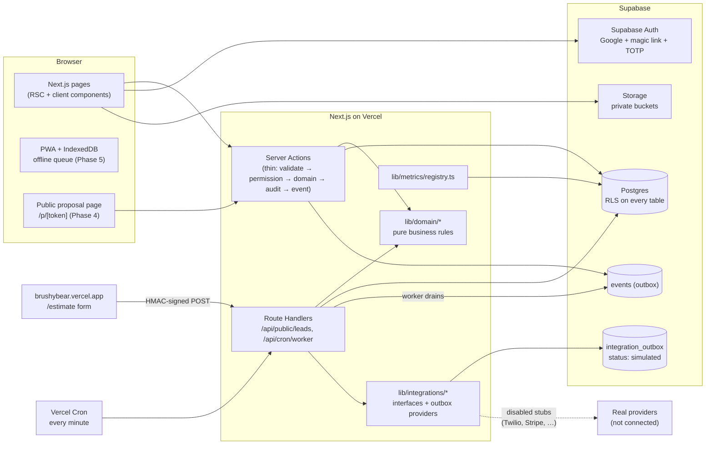

# Architecture

How the pieces fit together. Updated as each phase lands.

## Principles

- **Postgres is the enforcement point.** RLS on every table, deny by default. Server code re-checks permissions; the UI only hides what the server already denies.
- **Business rules are pure functions** in `lib/domain/*` (stage gates, pricing, ledger, scoring, attention rules, scheduling conflicts), unit-tested without a database.
- **One path per state change.** Job stages change only through `advanceJobStage()`; money only through ledger operations; balances are always derived.
- **Every mutation** is zod-validated, permission-checked, audit-logged (DB trigger) and emits a domain event into `events`.
- **Background work** runs from `events` via `/api/cron/worker` with `FOR UPDATE SKIP LOCKED` and idempotency keys.
- **Integrations** are adapters. The default provider writes to `integration_outbox`; real providers are disabled stubs until an owner connects them.
- **Metrics** are defined once in `lib/metrics/registry.ts` and aggregated server-side.

## Request paths (current)

| Path               | Rendering                     | Notes                          |
| ------------------ | ----------------------------- | ------------------------------ |
| `/` and nav routes | Static (Phase 0 placeholders) | Become dynamic as data arrives |
| `/login`           | Static                        | Auth wiring in Phase 1         |
| `/dev/ui`          | Static                        | 404 in production              |
| `/api/health`      | Dynamic                       | Liveness only                  |
