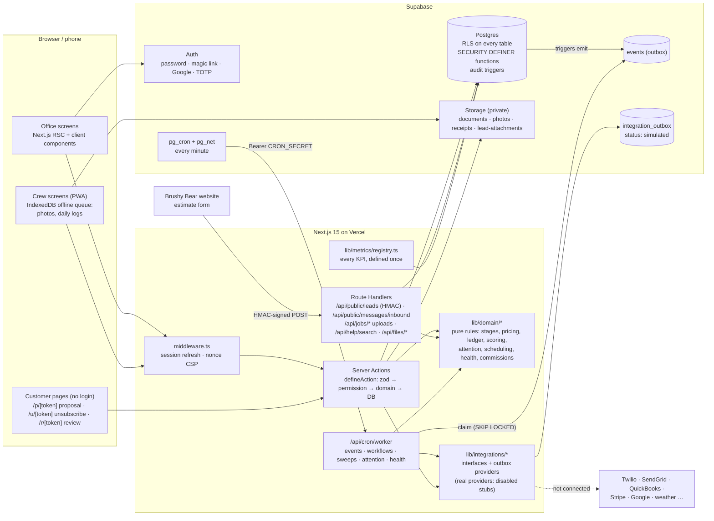

# Architecture

How the pieces of Brushy Bear CRM fit together (all 10 build phases). The source of truth for behavior is `docs/SPEC.md`; deviations are in `docs/DECISIONS.md`.

## Principles

- **Postgres is the enforcement point.** RLS on every table (deny by default; `supabase/tests/000_rls_everywhere.test.sql` fails otherwise). Server code re-checks permissions; the UI only hides what the server already denies. Writes that need more than one table go through `SECURITY DEFINER` functions that re-check the actor's permission and company.
- **Business rules are pure functions** in `lib/domain/*`, unit-tested without a database (Vitest). Server Actions and Route Handlers stay thin.
- **One path per state change.** Job stages change only through `advanceJobStage()` → `apply_job_stage_change()`; money only through ledger functions (`record_payment`, `mark_invoice_sent`, …); balances are always derived (views `job_ledger`, `invoice_ledger`, `payment_ledger`), never stored.
- **Every mutation** is zod-validated, permission-checked, audit-logged (database trigger into `audit_log`, with the real person and any View-as) and emits a domain event into `events`.
- **Background work** runs from `events` in `/api/cron/worker` (claims with `FOR UPDATE SKIP LOCKED`, idempotency keys, retries with backoff). The worker also runs the sweeps: workflows waiting on a timer, drips, campaigns, onboarding checks, production and money gates, on-time guarantee, overdue invoices, report schedules, job health, and the attention rules. Supabase `pg_cron` calls it every minute (RUNBOOK "Background worker"); the website intake runs its own lead's events right away so the text-back doesn't wait.
- **Integrations are adapters.** The default provider writes to `integration_outbox` with status `simulated`; real providers are disabled stubs until an owner connects them (`docs/INTEGRATIONS.md`). No code path calls a real external API.
- **Metrics** are defined once in `lib/metrics/registry.ts` and aggregated server-side (database functions), paginated and indexed.

## Request paths

| Path                                     | Rendering     | Notes                                                                                    |
| ---------------------------------------- | ------------- | ---------------------------------------------------------------------------------------- |
| `/login`, `/mfa`                         | Dynamic       | Password, magic link, Google; TOTP when the role requires it                             |
| `(app)/*` office and crew pages          | Dynamic (RSC) | Session from cookies; every query runs as the person (RLS)                               |
| `/p/[token]`, `/u/[token]`, `/r/[token]` | Dynamic       | No login; the token is the credential (hashed in the DB); rate limited per IP            |
| `/api/public/leads`                      | Route handler | HMAC signature + timestamp, idempotency key, rate limits (`docs/WEBSITE_INTEGRATION.md`) |
| `/api/public/messages/inbound`           | Route handler | HMAC; only when an SMS/email provider is connected                                       |
| `/api/cron/worker`                       | Route handler | `Authorization: Bearer $CRON_SECRET`; returns a JSON summary                             |
| `/api/health`                            | Route handler | Liveness only                                                                            |
| `/dev/ui`                                | Dynamic       | Design-system page; 404 in production                                                    |

Every page is rendered per request: the root layout reads the request headers so Next.js can put the per-request CSP nonce on its scripts (DECISIONS "Nonce-based CSP").

## Security layers

1. **Middleware:** refreshes the Supabase session, sends signed-out visitors to `/login`, and sets a nonce-based `Content-Security-Policy` (`'strict-dynamic'`, no inline scripts, connections only to the app and the Supabase project). `next.config.ts` adds HSTS, `X-Frame-Options: DENY`, `nosniff`, `Referrer-Policy` and `Permissions-Policy`.
2. **Cookies:** Supabase session cookies are `Secure` (outside local http), `SameSite=Lax`, path `/`.
3. **CSRF:** Server Actions only accept same-origin POSTs (Next.js checks `Origin` against the host); public route handlers need an HMAC signature.
4. **Permissions:** packs → role templates → per-person overrides, scopes `own/team/all` (`docs/PERMISSIONS.md`); checked in Postgres (`app.has_perm`, `app.perm_scope`) and again in actions.
5. **Secrets:** the service-role key is server-only (`import "server-only"`; CI greps the built client bundle for its name and value and fails if found); gate/lockbox codes are encrypted with `FIELD_ENCRYPTION_KEY` before they reach the database and are readable by owners/office or by the crew scheduled at that property today.
6. **Logs** never contain phone numbers or emails (`lib/log.ts` masks them; a test fails on direct `console` use).

## Code map

| Folder                    | What lives there                                                                                                                                                         |
| ------------------------- | ------------------------------------------------------------------------------------------------------------------------------------------------------------------------ |
| `app/(auth)`              | Login, magic-link callback, MFA                                                                                                                                          |
| `app/(app)`               | The signed-in app: Home, Leads, Jobs, Schedule, Attention, Accounts, Estimates, Invoices, Campaigns, Documents, Price Book, Analytics, My Numbers, Help, Settings, Admin |
| `app/p`, `app/u`, `app/r` | Customer pages (proposal & signing, unsubscribe, review link)                                                                                                            |
| `app/api`                 | Public intake, inbound messages, uploads, file streaming, help search, worker, health                                                                                    |
| `components/`             | shadcn primitives, shell (nav, search, help panel), lists framework, KPI cards, forms                                                                                    |
| `lib/domain/`             | Pure business logic + tests                                                                                                                                              |
| `lib/metrics/registry.ts` | KPI definitions                                                                                                                                                          |
| `lib/integrations/`       | Adapter interfaces, outbox providers, disabled real stubs                                                                                                                |
| `lib/permissions/`        | Permission catalog, packs, templates                                                                                                                                     |
| `lib/demo/`               | Demo data plan and guard (`pnpm seed:demo`)                                                                                                                              |
| `supabase/migrations/`    | Additive SQL migrations (rollbacks in `supabase/rollbacks/`)                                                                                                             |
| `supabase/tests/`         | SQL/RLS tests (`pnpm db:test`)                                                                                                                                           |
| `tests/e2e/`              | Playwright specs, incl. the SPEC §19 golden path (`golden-path.spec.ts`) and edge cases                                                                                  |
