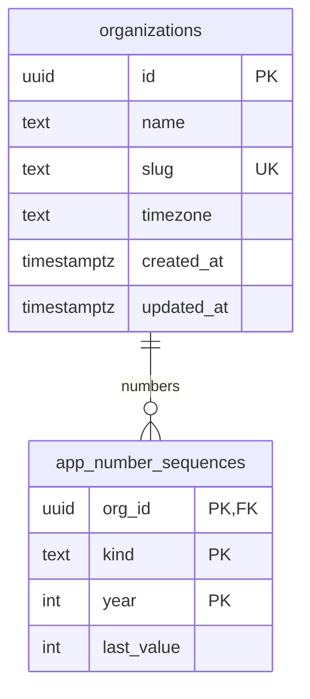
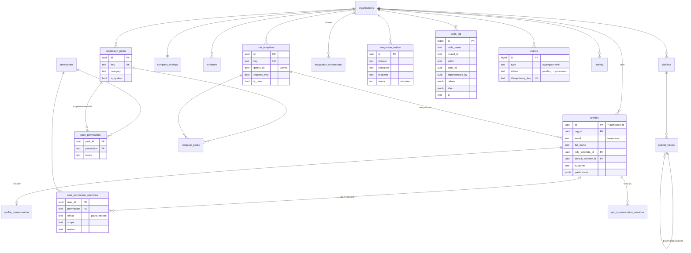
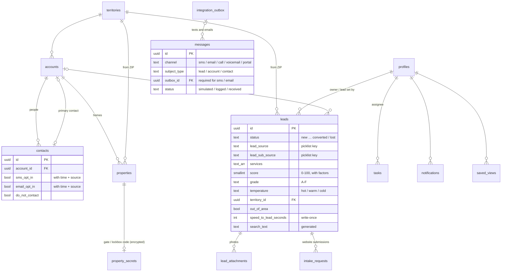
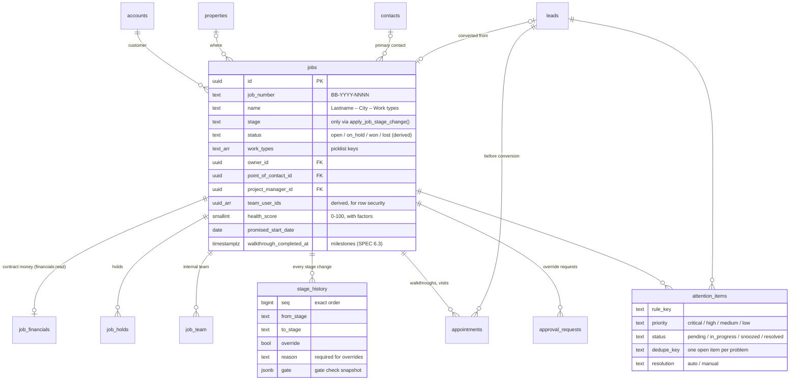
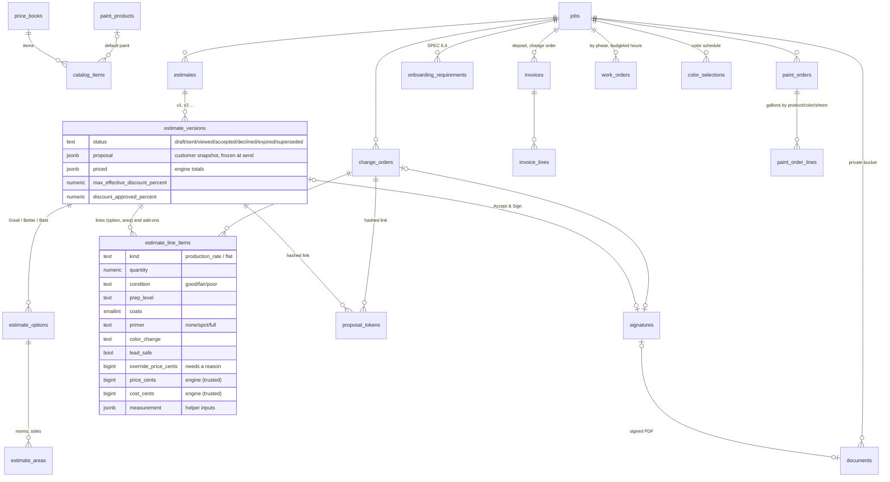
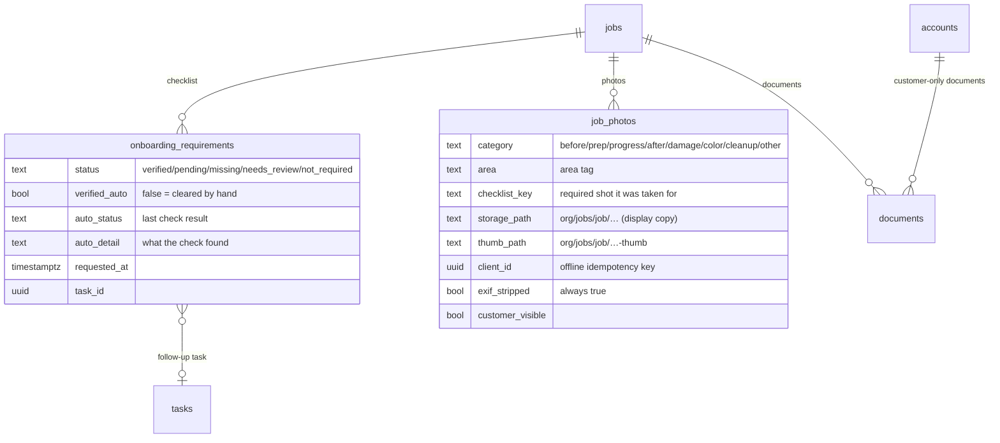
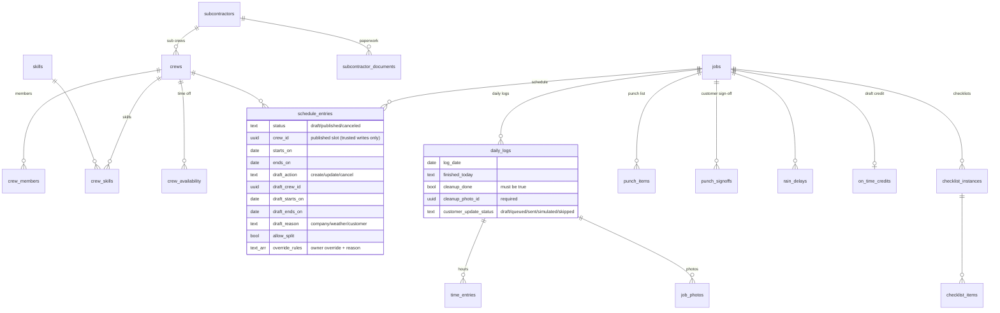
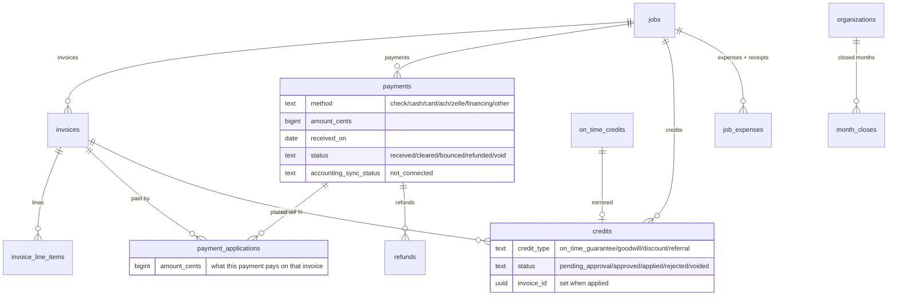
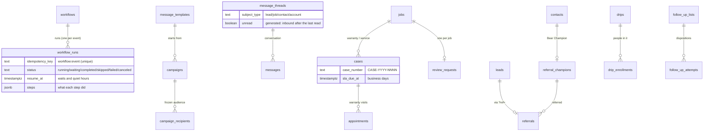

# Data model

Entity-relationship overview. Grows with each migration; SPEC §5 is the full target.

## Conventions (SPEC §5)

- `id uuid primary key default gen_random_uuid()`, `org_id uuid not null`, `created_at`, `updated_at`, `created_by`, `updated_by`, `deleted_at` (soft delete) on user-facing tables.
- Money: `bigint` cents. Quantities: `numeric(12,2)`. Rates: `numeric(12,4)`.
- Admin-editable choices are lookup tables (picklists); fixed sets are Postgres enums or `CHECK` constraints.
- Human-friendly numbers per org and per Pacific year via `app.next_number()`: `BB-2026-0001` (job), `EST-…`, `INV-…`, `PMT-…`, `WO-…`, `CO-…`.
- RLS enabled on every table (enforced by `supabase/tests/000_rls_everywhere.test.sql`).
- Private helpers live in the `app` schema (not exposed through the Data API).

## Phase 0 — foundation

| Object                           | Purpose                                                                                                               |
| -------------------------------- | --------------------------------------------------------------------------------------------------------------------- |
| `public.organizations`           | Tenants. Every business table will reference it.                                                                      |
| `app.number_sequences`           | Counters behind `app.next_number()`. Not readable by app users.                                                       |
| `app.next_number(org, kind, at)` | Concurrency-safe next number; year follows the org's time zone. Callable by `service_role` and definer triggers only. |
| `app.set_updated_at()`           | `BEFORE UPDATE` trigger function.                                                                                     |

## Phase 1 — platform

| Table                        | Purpose                                                                                                                            |
| ---------------------------- | ---------------------------------------------------------------------------------------------------------------------------------- |
| `permissions`                | Global catalog of `resource:action` permissions (86 after Phase 2). Kept in sync with `lib/permissions/catalog.ts` by a unit test. |
| `permission_packs`           | Named bundles of permissions with a scope each. System packs are read-only; owners can add custom packs.                           |
| `role_templates`             | Compose packs. One per user. Owner (`grants_all`) is locked. Flags: `requires_mfa`, `is_crew` (mobile crew view).                  |
| `user_permission_overrides`  | Per-user grants and revokes, with a required reason.                                                                               |
| `profiles`                   | CRM users (1:1 with `auth.users`). Never deleted, only turned off. The last active owner can't be turned off.                      |
| `profile_compensation`       | Hourly cost for job costing. HR permission only.                                                                                   |
| `territories`                | Service-area cities and ZIP codes. A ZIP belongs to at most one territory. Soft delete.                                            |
| `company_settings`           | One row per org: contact, licensing (placeholders), business hours, SLAs, season, deposit, estimate expiry, tax (unset).           |
| `picklists` / `_values`      | Admin-editable choices (lead sources and sub-sources, dispositions, work types, siding, sheens…). Keys are immutable.              |
| `audit_log`                  | Append-only change history written by triggers.                                                                                    |
| `events`                     | Domain events written by triggers; processed by the worker (idempotent, retried).                                                  |
| `activity`                   | Human-readable timeline entries per record (used from Phase 2).                                                                    |
| `integration_connections`    | One row per integration domain; `connected` is refused by a trigger in this build.                                                 |
| `integration_outbox`         | Everything that would have been sent. Status `simulated`.                                                                          |
| `app.impersonation_sessions` | Active View-as sessions keyed by the owner's auth session. Not exposed through the API.                                            |

Key functions (all in schema `app`, not exposed): `current_org_id()`, `effective_user_id()`, `user_perm_scope(user, perm)`, `has_perm(perm)`, `can_write(perm)`, `session_ok()`, `audit_row()`, `emit_change_event()`. Public RPCs: `my_access()`, `start_view_as()`, `stop_view_as()`, `integration_summary()`, `soft_delete_record()`, `restore_record()`, `list_deleted_records()`, `reorder_picklist_values()`.

## Phase 2 — leads & customers

Notes, comments, tasks, messages and activity attach to any record through `subject_type` + `subject_id`, and follow that record's visibility.

| Table                | Purpose                                                                                                                                           |
| -------------------- | ------------------------------------------------------------------------------------------------------------------------------------------------- |
| `accounts`           | A household or business. Owner, territory, status, tags. Soft delete.                                                                             |
| `contacts`           | People on an account, with consent: opt-in time and source for texts and email, opt-out, Do Not Contact. Soft delete.                             |
| `properties`         | Homes on an account. Territory from the ZIP; `lead_safe_required` is generated from the year built (before 1978). Soft delete.                    |
| `property_secrets`   | Gate / lockbox codes, encrypted in the app (AES-256-GCM, `FIELD_ENCRYPTION_KEY`). Readable only with `properties:view_access_codes`.              |
| `leads`              | Website and manual leads. Picklist keys checked by trigger, territory from ZIP, score/grade/temperature with factors, speed to lead (write-once). |
| `lead_attachments`   | Photos and files on a lead (private storage bucket `lead-attachments`). Can't be edited after upload.                                             |
| `notes`              | Notes on any record; priority, pinned. Authors edit their own.                                                                                    |
| `comments`           | Team comments with categories and @mentions; mentions create notifications (trigger).                                                             |
| `tasks`              | To-dos with due time, assignee and priority, optionally on a record.                                                                              |
| `messages`           | Append-only thread: texts, emails (must point at their outbox row), logged calls, portal messages. Text is kept out of the audit log.             |
| `notifications`      | Per-user notifications written by triggers and trusted code; people can only mark their own as read.                                              |
| `saved_views`        | Saved list views (filters, sort, columns), personal or shared.                                                                                    |
| `lead_scoring_rules` | Editable points per scoring factor (Admin → Lead Scoring).                                                                                        |
| `intake_requests`    | One row per website submission: idempotency key, body hash, outcome, the lead it made. Service role only.                                         |
| `rate_limits`        | Fixed-window counters for the public intake endpoints. Service role only.                                                                         |

New public RPCs: `search_records(query, scope, limit)` (universal search, runs as the caller), `lead_stats(now)` (Lead Dashboard), `lead_status_counts()` (list tabs), `consume_rate_limit()` (service role). `soft_delete_record()` now also requires edit rights on the record; `list_deleted_records()` / `restore_record()` cover leads, accounts, contacts and properties.

Migrations: `20261026000600_leads_customers`, `…0700_intake_claims`, `…0800_scoped_soft_delete`, `…0900_messages_trusted_delete`, `…1000_lead_list_performance`, each with a rollback in `supabase/rollbacks/`.

## Phase 3 — jobs core

| Table               | Purpose                                                                                                                                                              |
| ------------------- | -------------------------------------------------------------------------------------------------------------------------------------------------------------------- |
| `jobs`              | The opportunity (SPEC §5.3): customer, property, work types, stage, derived status, priority, team, dates, milestone timestamps, health. Soft delete.                |
| `job_financials`    | Contract baseline in cents (Phase 4 adds the contract amount from estimates and change orders). Read needs `financials:read`; write needs `job_admin:override`.      |
| `job_holds`         | Holds with type (picklist), reason, "blocks scheduling", who placed/released. Released holds stay for history. Hold counts on the job are kept by a trigger.         |
| `job_team`          | Internal team members by role (estimator, point of contact, project manager, office, painter).                                                                       |
| `stage_history`     | Append-only log of every stage change: from, to, who, override + reason, gate snapshot, approval request.                                                            |
| `appointments`      | Walkthroughs and visits for a lead or job (SPEC §5.4): type (scheduling work types), start/end, assignees, status, walkthrough result. Keeps `leads.walkthrough_at`. |
| `approval_requests` | Owner approvals. Phase 3: stage overrides requested by non-owners (one pending per job). Discounts, change orders and credits join later.                            |
| `attention_items`   | Problems the attention engine found (SPEC §9), with owner, due time, snooze, and auto/manual resolution. One open item per `dedupe_key`.                             |
| `attention_rules`   | Per-company on/off switch and thresholds for each rule (Admin → Attention Rules).                                                                                    |

New RPCs: `apply_job_stage_change()` and `convert_lead_to_job()` (service role only), `claim_events()` (worker, service role only), `job_stats(from, to, prev_from)` (Jobs Dashboard; money null without `financials:read`), `job_status_counts()` (Job List tabs), `attention_summary()` (Attention Center KPIs and the nav badge). `search_records()` now finds jobs by number and name; soft delete / Deleted Records / open work counts cover jobs. Notes, comments, tasks and messages accept `subject_type = 'job'`.

Migrations: `20261026001100_jobs_core`, `20261026001200_worker`, each with a rollback.

## Phase 4 — estimating

| Table                                                                                         | Purpose                                                                                                                                                                                                                                                    |
| --------------------------------------------------------------------------------------------- | ---------------------------------------------------------------------------------------------------------------------------------------------------------------------------------------------------------------------------------------------------------- |
| `estimate_settings`                                                                           | One per company: pricing knobs (`pricing` jsonb, SPEC §7.3), discount limits by role/user, "What's included" by work type, guarantees, lead-safe disclosure, `is_sample` + who calibrated it. Deposit %, expiry and tax config stay in `company_settings`. |
| `price_books`, `catalog_items`                                                                | The price book (one default). Items: family, type, unit, pricing method (production rate via `surface`, or flat price/cost), default coats/method/paint, work type, work-order phase, allowance flag, `is_sample`.                                         |
| `paint_products`                                                                              | Brand (picklist), product, use, sheens, coverage, cost per gallon, containers, primer flag, `is_sample`.                                                                                                                                                   |
| `production_rates`                                                                            | Units per labor hour and prep hours per unit by surface × method × condition, `is_sample`.                                                                                                                                                                 |
| `estimates`, `estimate_versions`, `estimate_options`, `estimate_areas`, `estimate_line_items` | The estimate tree. Line items also belong to change orders (`change_order_id`, `is_credit`). Engine columns (hours, gallons, cost, computed and final price, issues) are written only by trusted server code; sent content can't change.                   |
| `change_orders`                                                                               | Number `CO-…`, title, reason, field notes (crew-reported), status, totals, snapshot, "bill separately".                                                                                                                                                    |
| `proposal_tokens`                                                                             | SHA-256 of each customer link, expiry, revoked/used, view count.                                                                                                                                                                                           |
| `signatures`                                                                                  | Typed name, signature PNG + hash, consent text, IP, user agent, selection (option, add-ons, totals), time. Never changes; trusted code links the signed PDF.                                                                                               |
| `documents`                                                                                   | Files in the private `documents` bucket (category, status, hash, related record, customer-visible flag). Soft delete.                                                                                                                                      |
| `agreement_templates`                                                                         | BearSign templates by doc type: body with merge fields and [SLOTS], conditional clauses (lead-safe, HOA), status draft/published, version, approval.                                                                                                       |
| `invoices`, `invoice_lines`                                                                   | Phase 4 creates the deposit invoice and change-order invoices as drafts (one deposit per job). Payments and the ledger arrive in Phase 7.                                                                                                                  |
| `onboarding_requirements`                                                                     | The SPEC §6.4 checklist seeded on acceptance (14 keys, required by rule), with status and auto-verify rule.                                                                                                                                                |
| `paint_orders`, `paint_order_lines`                                                           | Paint drafted from the accepted lines (`PO-…`): gallons and containers by product, color and sheen, cost.                                                                                                                                                  |
| `work_orders` (+ `work_order_costs`)                                                          | Drafted by phase (prep, repair, paint, touch-up…) with budgeted hours from the accepted lines.                                                                                                                                                             |
| `color_selections`                                                                            | The color schedule per area and surface, seeded from the accepted lines; brand, color, code, sheen, product, confirmed.                                                                                                                                    |

`job_financials` gains `estimate_contract_cents`, `change_orders_cents` and a generated `contract_cents` (estimate + change orders, else the baseline). `jobs` gains `accepted_estimate_id` and the estimate SLA reads `estimate_sent_at`.

New RPCs (service role only unless noted): `mark_estimate_sent`, `resolve_proposal_token`, `record_proposal_view`, `accept_estimate`, `decline_proposal`, `expire_proposals`, `store_version_pricing`, `store_change_order_pricing`, `approve_version_discount`, `mark_change_order_sent`, `accept_change_order`, `attach_signed_document`; for signed-in users: `create_estimate`, `copy_estimate_version`, `estimate_stats(from, to)`, `estimate_status_counts()`. `job_stats` reads `contract_cents`. Seed function `app.seed_estimating_defaults(org)` loads the sample configuration.

Migrations: `20261027000100_estimating`, `20261027000200_estimating_seed`, each with a rollback.

## Added in Phase 5 — Onboarding, documents & photos

| Table / column                                                                                      | Purpose                                                                                                                                                                                                                                                                                                      |
| --------------------------------------------------------------------------------------------------- | ------------------------------------------------------------------------------------------------------------------------------------------------------------------------------------------------------------------------------------------------------------------------------------------------------------ |
| `onboarding_requirements` + `auto_status`, `auto_detail`, `requested_at`, `requested_by`, `task_id` | The check result for each item (written by `apply_onboarding_checks()`), when it was requested from the customer, and its follow-up task. A manual clear is `status = verified` with `verified_auto = false` and a `note`; checks never overwrite it. Clearing `deposit_received` releases the Deposit Hold. |
| `job_photos`                                                                                        | Job photos in the private `photos` bucket: display copy (≤ 2,560 px JPEG, no metadata) + thumbnail (480 px), category, area, caption, checklist shot, size, dimensions, hash, taken-at, uploader, source (upload/camera/offline), shared with the customer. Unique `(job_id, client_id)`. Soft delete.       |
| `documents` (Phase 4 table)                                                                         | Now also uploads: any of PDF, images, Word, Excel, text, CSV up to 25 MB; a document can move to another job of the same customer or stay on the customer only; signed documents can't be deleted; soft delete and restore.                                                                                  |
| `messages.template_key`                                                                             | Which template a message came from (`prep_instructions`, `onboarding_*`, `photo_share`).                                                                                                                                                                                                                     |

New functions: `apply_onboarding_checks(job, results)` (service role), `app.onboarding_cleared(job)` (service role), `app.job_gate_passes('onboarding')` (real), `document_stats(job?)` and `job_photo_summary(job)` (signed-in users, row security applies), `app.job_in_scope(scope, job)`. `soft_delete_record`, `restore_record` and `list_deleted_records` cover `documents` and `job_photos`.

Storage: private buckets `documents` (25 MB, document types) and `photos` (15 MB, JPEG/PNG/WebP). Files are only read by server code after a row-security check.

Migration: `20261027000300_onboarding_documents_photos`, with a rollback.

## Added in Phase 6 — Production

| Table / column                                                       | Purpose                                                                                                                                                                                                                                                 |
| -------------------------------------------------------------------- | ------------------------------------------------------------------------------------------------------------------------------------------------------------------------------------------------------------------------------------------------------- |
| `skills`, `crew_skills` (`expires_on`)                               | Skills (interior, high-access exterior, spray, RRP certified, …) and which crews have them; certifications can expire.                                                                                                                                  |
| `subcontractors`, `subcontractor_documents`                          | Subcontractor companies; insurance / license / W-9 files with expiry in the private documents bucket. `status` (active / expiring / suspended) is computed by the database.                                                                             |
| `crews`, `crew_members`, `crew_availability`                         | Employee or subcontractor crews (lead, home territory, max jobs per day, day capacity), members (a user or a name, role lead / painter / helper), time off and company blackout days.                                                                   |
| `work_types`, `work_rules`, `schedule_settings`                      | SPEC §15.1 work types with durations and required skill; the 11 scheduling rules (on/off, block or warn, owner override, parameters); production days, day start, arrival window, crew-day hours, recommendation approval / auto-execute / undo window. |
| `jobs` + `crew_id`, `guarantee_start_date`, `priority_reschedule_at` | The job's crew, the date the on-time promise is measured against, and when it became a rain-priority reschedule.                                                                                                                                        |
| `schedule_entries`                                                   | Bars on the Master Schedule: the published slot and the pending draft in one row (see DECISIONS "drafts until Publish").                                                                                                                                |
| `schedule_recommendations`                                           | Ranked crew/date suggestions (score, reasons), approved / rejected / undone.                                                                                                                                                                            |
| `weather_forecasts`                                                  | Forecast cache for the weather adapter (empty while weather isn't connected).                                                                                                                                                                           |
| `rain_delays`                                                        | Rain days (no money columns); sets `is_priority_reschedule`.                                                                                                                                                                                            |
| `on_time_credits`                                                    | One drafted credit per job (amount from Company Settings), `pending_approval` → `approved` / `waived` → `applied` (Phase 7). Created only by the system.                                                                                                |
| `checklist_templates`, `checklist_instances`, `checklist_items`      | §15.1 checklists, copied onto a job (optionally a work order) and ticked by crew or office.                                                                                                                                                             |
| `daily_logs`, `time_entries`                                         | The evening update (finished, next up, issues, weather, cleanup + photo, customer update status) and hours per person (from the log, or clocked later).                                                                                                 |
| `job_photos` + `daily_log_id`, `work_order_id`                       | Photos linked to a daily log or work order.                                                                                                                                                                                                             |
| `punch_items`, `punch_signoffs`                                      | Touch-ups by area with before/fixed photos; the customer's immutable sign-off (name, signature PNG + SHA-256, statement, open items, IP, device).                                                                                                       |
| `attention_items.subject_type`                                       | Adds `subcontractor`.                                                                                                                                                                                                                                   |

New functions: `public.production_stats()` (Command Center numbers, money only with `financials:read`), `public.emit_production_event(type, aggregate, id, payload)` (service role, whitelisted types), `app.job_materials_ready(job)`, `app.job_crew_user_ids(job, crew)`, `app.refresh_job_teams(…)`, `app.jobs_for_crew(crew)`, `app.subcontractor_status(sub, date)`, `app.production_today()`, `app.seed_production_defaults(org)`; `app.job_gate_passes` covers gates 6–9.

Migrations: `20261027000400_production`, `20261027000500_production_seed`, each with a rollback.

## Added in Phase 7 — Money

| Table / column                 | Purpose                                                                                                                                                                                                              |
| ------------------------------ | -------------------------------------------------------------------------------------------------------------------------------------------------------------------------------------------------------------------- |
| `payments`                     | Money received for a job (method, amount, date, reference, status). Never deleted; bounced / void (reason required) stop counting. `void` is beyond the SPEC list (entered by mistake).                              |
| `payment_applications`         | Which invoices a payment pays and how much (forced application). One row per payment and invoice. Applications of bounced, void or refunded money are kept but ignored by the ledger.                                |
| `refunds`                      | Money given back from a payment (amount, date, method, reason); `detail` records how it came off (unapplied first, then invoices newest first).                                                                      |
| `credits`                      | Credits that lower the contract. On-time guarantee credits are mirrored from `on_time_credits` on approval (`on_time_credit_id`). `invoice_id` + status `applied` once placed on the final invoice or a credit memo. |
| `month_closes`                 | One row per company and month: closed (with summary snapshot and note) or reopened (who, when, why). Closed months lock money records dated in them.                                                                 |
| `job_expenses`                 | Other job costs (materials, subcontractor, equipment, permit, disposal, other) with an optional receipt (JPEG or PDF) in the private `receipts` bucket; soft delete with a reason.                                   |
| `invoices` + `pdf_document_id` | The PDF stored in Documents when the invoice was sent. One live final invoice per job (`invoices_one_final_idx`). `status` is kept current by the database.                                                          |
| `saved_views.module`           | Adds `invoices`.                                                                                                                                                                                                     |
| Views `invoice_ledger`         | Per invoice: collected, balance, days past due, display status, issued. Security invoker; amounts only with `financials:read`.                                                                                       |
| Views `payment_ledger`         | Per payment: applied, refunded, unapplied, available.                                                                                                                                                                |
| Views `job_ledger`             | Per job: contract base, credits, pending credits, contract, billed, left to bill, collected, balance, due, unapplied, refunded, uncleared, open / overdue invoice counts.                                            |

**No stored balances.** No table has a balance, paid, collected, outstanding, amount-due, left-to-bill or unapplied column; `supabase/tests/013_money.test.sql` fails if one appears. Every figure comes from the views (or `lib/domain/ledger` in TypeScript, checked against the same scenario).

New functions (all writes are `service_role` only and re-check the actor's permission and company): `create_invoice`, `update_invoice_draft`, `mark_invoice_sent`, `void_invoice`, `record_payment`, `set_payment_applications`, `update_payment_status` (clear / bounce / void), `refund_payment`, `create_credit`, `decide_credit`, `place_job_credits`, `draft_final_invoice`, `close_month`, `reopen_month`, `sweep_invoices`; `public.finance_stats(from, to)` (security invoker, every money KPI); `app.invoice_display_status(…)`, `app.refresh_invoice_status(invoice)`, `app.job_money(job)`, `app.money_locked(org, day)`, `app.check_money_lock(…)`, `app.require_actor_perm(…)`, `app.require_actor_org(org)`, `app.seed_money_defaults(org)`. `app.job_gate_passes` covers gates 10–12; `search_records` returns invoices.

Migration: `20261028000100_money`, with a rollback.

## Added in Phase 8 — Communication & growth

| Table / column                                                                      | Purpose                                                                                                                                                                                                |
| ----------------------------------------------------------------------------------- | ------------------------------------------------------------------------------------------------------------------------------------------------------------------------------------------------------ |
| `message_templates`                                                                 | SMS and email wording per key and channel, category, transactional or marketing, `status` draft/approved (approved by an owner; editing resets it), `is_system`, `active`. 88 seeded as drafts.        |
| `workflows`                                                                         | One row per seeded workflow key: `enabled`, `disabled_reason`. The definitions are in code.                                                                                                            |
| `workflow_runs`                                                                     | Every run: event, subject, status, current step, `resume_at`, step log, error; unique `idempotency_key`. Not audited (it's a log).                                                                     |
| `message_threads`                                                                   | One per subject; last message summary, last inbound, `read_at` / `read_by`, generated `unread`. `messages.thread_id` is set by a trigger. Not audited.                                                 |
| `messages` + columns                                                                | `thread_id`, `message_type` (transactional/marketing), `workflow_run_id`, `campaign_id`, `provider_message_id` (inbound idempotency).                                                                  |
| `cases`                                                                             | Warranty / service cases: job and/or account, contact, type, priority, status, source, SLA due, first response, resolution (required to resolve). `appointments.case_id` links warranty visits.        |
| `referral_settings`                                                                 | When a reward is payable (paid in full / sold), code prefix, program note and terms (drafts).                                                                                                          |
| `referral_champions`                                                                | A contact's Bear Champion code (generated, unique, never changes) and status.                                                                                                                          |
| `referrals`                                                                         | Champion → lead and/or job, source (`ref_link` / `manual`), reward amount copied at the time, payable / paid (method, reference), not-eligible reason. Status is derived.                              |
| `review_requests`                                                                   | One per job: channel, status (sent/skipped/clicked/reviewed), tracked link token hash, clicks, review left, rating, platform.                                                                          |
| `segments`                                                                          | Saved audiences (module, match, rules); not used by the screens yet.                                                                                                                                   |
| `campaigns`                                                                         | Name, channel, audience (module + rules), template, subject, body, status (draft → scheduled → sending → sent; paused, canceled), times, last test. The guard allows content changes only in draft.    |
| `campaign_recipients`                                                               | The audience frozen at send time: contact or lead, address, status (pending/excluded/sent/failed/deferred), exclusion reason, message and outbox ids, replied / unsubscribed / converted. Not audited. |
| `drips` + `drip_enrollments`                                                        | Drip steps (delay or date, channel, template) and exit conditions; enrollments with current step, next run, step log, exit reason.                                                                     |
| `follow_up_lists`, `follow_up_dispositions`, `follow_up_attempts`                   | List names, scripts, cooldowns; dispositions (group, lead disposition, needs a callback, sets Do Not Contact); every logged outcome (immutable).                                                       |
| `notification_settings`, `notification_preferences`                                 | Company default and each person's choice per notification type (in-app / email / text; required). Applied by a trigger on `notifications`.                                                             |
| `messaging_settings`                                                                | Quiet hours, customer-initiated window, STOP line, email footer, review / referral delays, case SLA.                                                                                                   |
| `leads.sms_opted_out_at`, `leads.email_opted_out_at`, `contacts.email_opted_out_at` | STOP and unsubscribe. `rain_delays.notify_customer` (workflow 9 condition).                                                                                                                            |

New functions: `approve_template`, `mark_thread_read`, `emit_domain_event` (service role; fixed list of event types), `claim_workflow_runs`, `claim_drip_enrollments`, `communication_stats(from, to)` (security invoker), `workflow_stats()`, `users_with_permission(org, permission)` (service role), `app.seed_communication_defaults(org)`; triggers for templates, workflows, threads, cases (number, SLA, activity), champions (code), referrals (no double pay), `leads_referral` (`?ref=`), campaigns (status rules), drip enrollments (people may only stop one), notifications (preferences). `number_sequences` gains `case` (`CASE-…`) and `paint_order` kinds; `attention_items.subject_type` gains `case`.

Migrations: `20261029000100_communication` and `20261029000200_communication_seed`, each with a rollback.
