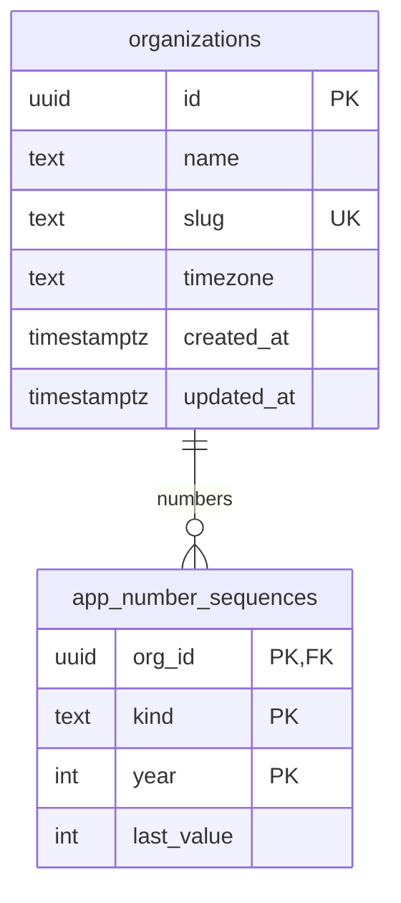

# Data model

Entity-relationship overview. Grows with each migration; SPEC §5 is the full target.

## Conventions (SPEC §5)

- `id uuid primary key default gen_random_uuid()`, `org_id uuid not null`, `created_at`, `updated_at`, `created_by`, `updated_by`, `deleted_at` (soft delete) on user-facing tables.
- Money: `bigint` cents. Quantities: `numeric(12,2)`. Rates: `numeric(12,4)`.
- Admin-editable choices are lookup tables (picklists); fixed sets are Postgres enums or `CHECK` constraints.
- Human-friendly numbers per org and per Pacific year via `app.next_number()`: `BB-2026-0001` (job), `EST-…`, `INV-…`, `PMT-…`, `WO-…`, `CO-…`.
- RLS enabled on every table (enforced by `supabase/tests/000_rls_everywhere.test.sql`).
- Private helpers live in the `app` schema (not exposed through the Data API).

## Phase 0 — foundation

| Object                           | Purpose                                                                                                               |
| -------------------------------- | --------------------------------------------------------------------------------------------------------------------- |
| `public.organizations`           | Tenants. Every business table will reference it.                                                                      |
| `app.number_sequences`           | Counters behind `app.next_number()`. Not readable by app users.                                                       |
| `app.next_number(org, kind, at)` | Concurrency-safe next number; year follows the org's time zone. Callable by `service_role` and definer triggers only. |
| `app.set_updated_at()`           | `BEFORE UPDATE` trigger function.                                                                                     |

## Phase 1 — platform

| Table                        | Purpose                                                                                                                            |
| ---------------------------- | ---------------------------------------------------------------------------------------------------------------------------------- |
| `permissions`                | Global catalog of `resource:action` permissions (86 after Phase 2). Kept in sync with `lib/permissions/catalog.ts` by a unit test. |
| `permission_packs`           | Named bundles of permissions with a scope each. System packs are read-only; owners can add custom packs.                           |
| `role_templates`             | Compose packs. One per user. Owner (`grants_all`) is locked. Flags: `requires_mfa`, `is_crew` (mobile crew view).                  |
| `user_permission_overrides`  | Per-user grants and revokes, with a required reason.                                                                               |
| `profiles`                   | CRM users (1:1 with `auth.users`). Never deleted, only turned off. The last active owner can't be turned off.                      |
| `profile_compensation`       | Hourly cost for job costing. HR permission only.                                                                                   |
| `territories`                | Service-area cities and ZIP codes. A ZIP belongs to at most one territory. Soft delete.                                            |
| `company_settings`           | One row per org: contact, licensing (placeholders), business hours, SLAs, season, deposit, estimate expiry, tax (unset).           |
| `picklists` / `_values`      | Admin-editable choices (lead sources and sub-sources, dispositions, work types, siding, sheens…). Keys are immutable.              |
| `audit_log`                  | Append-only change history written by triggers.                                                                                    |
| `events`                     | Domain events written by triggers; processed by the worker (idempotent, retried).                                                  |
| `activity`                   | Human-readable timeline entries per record (used from Phase 2).                                                                    |
| `integration_connections`    | One row per integration domain; `connected` is refused by a trigger in this build.                                                 |
| `integration_outbox`         | Everything that would have been sent. Status `simulated`.                                                                          |
| `app.impersonation_sessions` | Active View-as sessions keyed by the owner's auth session. Not exposed through the API.                                            |

Key functions (all in schema `app`, not exposed): `current_org_id()`, `effective_user_id()`, `user_perm_scope(user, perm)`, `has_perm(perm)`, `can_write(perm)`, `session_ok()`, `audit_row()`, `emit_change_event()`. Public RPCs: `my_access()`, `start_view_as()`, `stop_view_as()`, `integration_summary()`, `soft_delete_record()`, `restore_record()`, `list_deleted_records()`, `reorder_picklist_values()`.

## Phase 2 — leads & customers

Notes, comments, tasks, messages and activity attach to any record through `subject_type` + `subject_id`, and follow that record's visibility.

| Table                | Purpose                                                                                                                                           |
| -------------------- | ------------------------------------------------------------------------------------------------------------------------------------------------- |
| `accounts`           | A household or business. Owner, territory, status, tags. Soft delete.                                                                             |
| `contacts`           | People on an account, with consent: opt-in time and source for texts and email, opt-out, Do Not Contact. Soft delete.                             |
| `properties`         | Homes on an account. Territory from the ZIP; `lead_safe_required` is generated from the year built (before 1978). Soft delete.                    |
| `property_secrets`   | Gate / lockbox codes, encrypted in the app (AES-256-GCM, `FIELD_ENCRYPTION_KEY`). Readable only with `properties:view_access_codes`.              |
| `leads`              | Website and manual leads. Picklist keys checked by trigger, territory from ZIP, score/grade/temperature with factors, speed to lead (write-once). |
| `lead_attachments`   | Photos and files on a lead (private storage bucket `lead-attachments`). Can't be edited after upload.                                             |
| `notes`              | Notes on any record; priority, pinned. Authors edit their own.                                                                                    |
| `comments`           | Team comments with categories and @mentions; mentions create notifications (trigger).                                                             |
| `tasks`              | To-dos with due time, assignee and priority, optionally on a record.                                                                              |
| `messages`           | Append-only thread: texts, emails (must point at their outbox row), logged calls, portal messages. Text is kept out of the audit log.             |
| `notifications`      | Per-user notifications written by triggers and trusted code; people can only mark their own as read.                                              |
| `saved_views`        | Saved list views (filters, sort, columns), personal or shared.                                                                                    |
| `lead_scoring_rules` | Editable points per scoring factor (Admin → Lead Scoring).                                                                                        |
| `intake_requests`    | One row per website submission: idempotency key, body hash, outcome, the lead it made. Service role only.                                         |
| `rate_limits`        | Fixed-window counters for the public intake endpoints. Service role only.                                                                         |

New public RPCs: `search_records(query, scope, limit)` (universal search, runs as the caller), `lead_stats(now)` (Lead Dashboard), `lead_status_counts()` (list tabs), `consume_rate_limit()` (service role). `soft_delete_record()` now also requires edit rights on the record; `list_deleted_records()` / `restore_record()` cover leads, accounts, contacts and properties.

Migrations: `20261026000600_leads_customers`, `…0700_intake_claims`, `…0800_scoped_soft_delete`, `…0900_messages_trusted_delete`, `…1000_lead_list_performance`, each with a rollback in `supabase/rollbacks/`.
