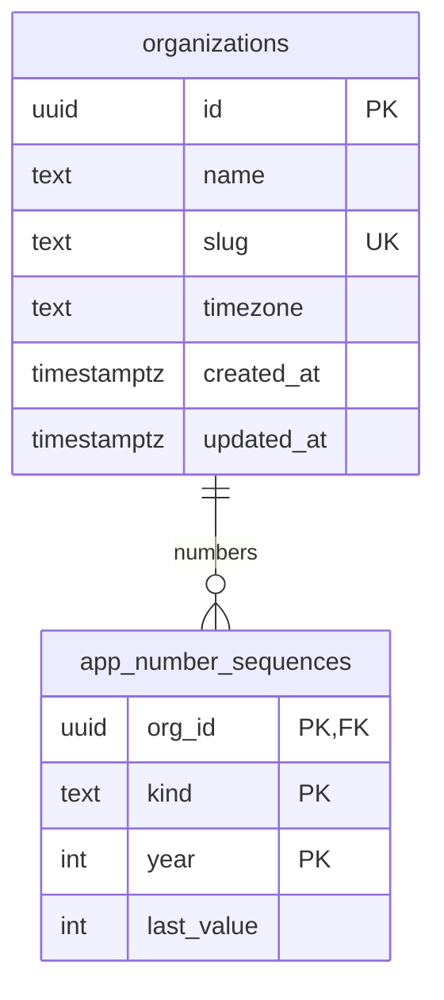

# Data model

Entity-relationship overview. Grows with each migration; SPEC §5 is the full target.

## Conventions (SPEC §5)

- `id uuid primary key default gen_random_uuid()`, `org_id uuid not null`, `created_at`, `updated_at`, `created_by`, `updated_by`, `deleted_at` (soft delete) on user-facing tables.
- Money: `bigint` cents. Quantities: `numeric(12,2)`. Rates: `numeric(12,4)`.
- Admin-editable choices are lookup tables (picklists); fixed sets are Postgres enums or `CHECK` constraints.
- Human-friendly numbers per org and per Pacific year via `app.next_number()`: `BB-2026-0001` (job), `EST-…`, `INV-…`, `PMT-…`, `WO-…`, `CO-…`.
- RLS enabled on every table (enforced by `supabase/tests/000_rls_everywhere.test.sql`).
- Private helpers live in the `app` schema (not exposed through the Data API).

## Current schema (Phase 0)

| Object                           | Purpose                                                                                                               |
| -------------------------------- | --------------------------------------------------------------------------------------------------------------------- |
| `public.organizations`           | Tenants. Every business table will reference it.                                                                      |
| `app.number_sequences`           | Counters behind `app.next_number()`. Not readable by app users.                                                       |
| `app.next_number(org, kind, at)` | Concurrency-safe next number; year follows the org's time zone. Callable by `service_role` and definer triggers only. |
| `app.set_updated_at()`           | `BEFORE UPDATE` trigger function.                                                                                     |
